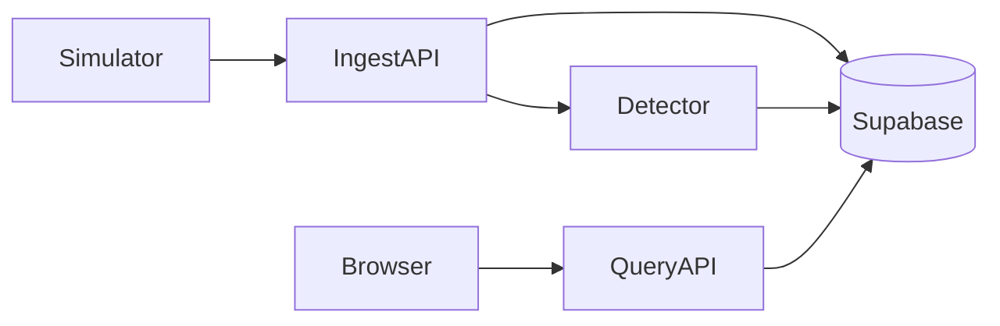

# Signal Analytics Platform

A web app for engineers and plant operators to watch a steel rolling mill, look back at stored signals, and inspect abnormal events. There is no physical PLC. A seeded simulator stands in for the mill and posts readings into the app.

The build is one shared challenge for Data Engineer and AI Engineer applicants. Finished work needs a GitHub repo, a live URL, setup instructions, and a way for a reviewer to sign in.

## Architecture



The browser handles login, live monitoring, history, and incidents. It talks to the Next.js app on Vercel. That app has three server pieces:

- **Ingest API** receives batches and saves them.
- **Detector** scores each batch with rules and a z-score, then records alerts.
- **Query API** serves history and alerts.

Supabase provides authentication and Postgres. Stored data is Auth, Readings, Rollups, and Alerts.

The simulator is a local process. It does not write to the database itself.

## Shared contracts

One mill for the first build: `RM-01`.

| Signal | Unit | Role |
| --- | --- | --- |
| `motor_current` | A | Drive load |
| `motor_speed` | rpm | Line speed |
| `torque` | Nm | Mechanical load |
| `vibration` | mm/s | Mechanical disturbance |
| `rolling_force` | kN | Stand force |
| `temperature` | C | Slow thermal drift |

Each sample has a mill id, signal id, event timestamp, numeric value, and unit:

```json
{
  "mill_id": "RM-01",
  "signal": "motor_current",
  "timestamp": "2026-10-19T10:00:00.020Z",
  "value": 126.5,
  "unit": "A"
}
```

Sampling is 50 Hz, which is one sample every 20 ms. The simulator still posts about one second per request: 50 timestamps times 6 signals. Charts read 1-second rollups. Raw rows exist so an incident view can zoom in.

Replay window is 10 minutes starting at `2026-10-19T10:00:00.000Z`.

| Window | Behavior |
| --- | --- |
| 0:00–4:00 | Normal operation, small natural variation |
| 4:00–6:00 | Legitimate speed and load step. Must not alert |
| 6:30 for about 8 seconds | Cobble: current and vibration spike, speed and force drop |
| After the cobble | Recovery toward normal |

The same seed must reproduce the same series and the same cobble timestamp.

## Auth split

- People use Supabase email and password. Signed-in users can read. Anonymous users cannot.
- The simulator calls ingest with `INGEST_SECRET`. It is not a user session.
- The service role key stays on the server and is the only writer of readings, rollups, and alerts.

## Phase order

The browser shell is built before the data pipeline so the screens can be walked through against a local preview of the replay. Ingest, the detector, and the query API keep their contracts. The query API replaces the preview; it does not invent new screens.

1. [Foundation](phase-01-foundation.md) — app shell, env, Supabase clients
2. [Database](phase-02-database.md) — Auth, Readings, Rollups, Alerts
3. [Simulator](phase-03-simulator.md) — seeded 50 Hz generator
4. [Browser](phase-07-browser.md) — login, live, history, incidents, reading the preview replay
5. [Ingest](phase-04-ingest.md) — batch save
6. [Detector](phase-05-detector.md) — rules and z-score
7. [Query API](phase-06-query-api.md) — live, history, alerts; replaces the preview
8. [Ship](phase-08-ship.md) — README, demo account, deployment checklist

File names keep their original numbers. The list above is the build order.

## Done

A reviewer can sign in, watch `RM-01`, scrub history, and open the cobble alert. The alert shows when it happened, which signals moved, and why. The load-step period stays quiet. Local setup and the simulator command are documented.
